# Azure Infrastructure as Code with Terraform

**Created and implemented by Mark Culberson**  
**Cloud Engineering • Microsoft Azure • Terraform (HCL) • Azure Networking • Infrastructure Troubleshooting**

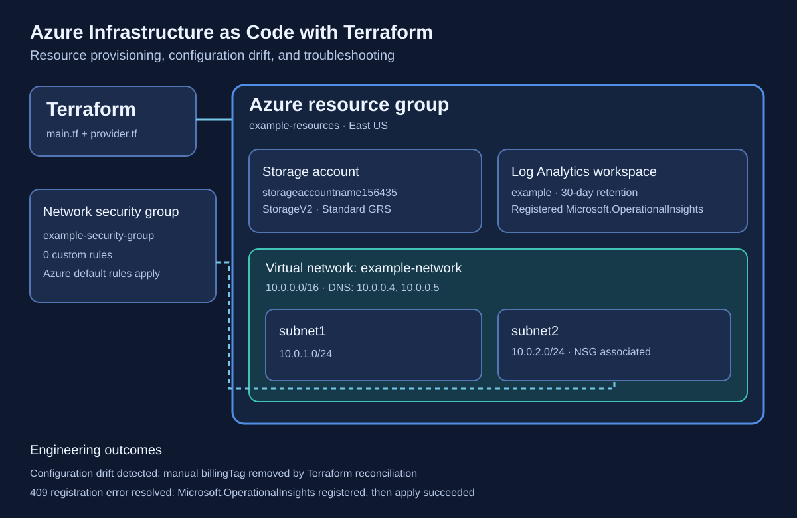

## Project objective

Learn how to provision and manage Microsoft Azure infrastructure using **HashiCorp Terraform** instead of relying only on manual Azure Portal configuration. Progress from a resource group to storage, networking, network security, and a Log Analytics workspace; observe Terraform's handling of configuration drift; and troubleshoot an Azure resource-provider prerequisite that blocks deployment.

This repository is a **hands-on learning portfolio**, not a production-ready Terraform module. The published Terraform files were **sanitized and reconstructed from screenshots**, so they should be checked against the original local configuration before reuse.

## Implemented environment

| Component | Documented deployment / configuration |
|---|---|
| Resource group | `example-resources`, East US |
| Storage account | `storageaccountname156435`, StorageV2, Standard GRS; `environment=staging` |
| Virtual network | `example-network`, `10.0.0.0/16` |
| Subnet 1 | `subnet1`, `10.0.1.0/24` |
| Subnet 2 | `subnet2`, `10.0.2.0/24`; associated with NSG |
| Network security group | `example-security-group`; no custom security rules shown |
| Log Analytics workspace | `example`, `PerGB2018` consumption SKU, 30-day retention |
| AzureRM provider | Sanitized `provider.tf` currently pins `hashicorp/azurerm` to `5.0.0` |
| Terraform drift exercise | Azure Portal-only tag `billingTag=WHOP` detected as an in-place update |
| Resource-provider dependency | `Microsoft.OperationalInsights` registered after HTTP 409; workspace subsequently provisioned |

## Architecture overview

The resource group contains the storage account, VNet and subnets, NSG, and Log Analytics workspace. The NSG is associated with the second subnet. The architectural diagram illustrates Terraform's desired-state configuration and Azure resources; it should **not** be read as evidence that diagnostic settings or log ingestion were configured.

**Documented implementation sequence:**

1. Configure the AzureRM provider and declare an Azure resource group in HCL.
2. Review a `terraform plan`, apply it, and verify resource-group creation in Azure Portal.
3. Create a tag manually in Azure Portal to demonstrate configuration drift.
4. Use Terraform plan output to identify and reconcile the untracked change while adding Azure Storage.
5. Extend the declared infrastructure with a VNet, two subnets, an NSG, and Log Analytics workspace.
6. Diagnose `MissingSubscriptionRegistration` after a partially successful apply.
7. Register `Microsoft.OperationalInsights`, retry the apply, and verify Azure resources.

## Infrastructure security and operational design

- **Versioned infrastructure definition:** HCL makes resource declarations reviewable and reproducible in principle.
- **Drift awareness:** A manual Azure Portal tag change was visible in Terraform's planned state reconciliation.
- **Network segmentation foundation:** Two separate subnets provide logical address segmentation; the NSG association is documented, but custom allow/deny rules were not evidenced.
- **Storage posture:** The screenshots showed public network access and shared-key access enabled. These choices would require additional review and restriction in a production environment.
- **State and credential hygiene:** The repository's `.gitignore` excludes local state, Terraform working directories, plans, and sensitive files. **Ignore rules alone do not prove remote-state security or credential rotation.**
- **Observability foundation:** Provisioning a Log Analytics workspace lays the groundwork for centralized logs, but does not demonstrate that diagnostic sources are connected or sending telemetry.

## Challenges and problem-solving

**Challenge 1 — configuration drift:** I changed the resource group's `billingTag` in Azure Portal without updating HCL. Terraform later proposed an in-place change that would remove that unmanaged tag. This showed me how **desired state**, actual Azure state, and Terraform's planned actions can diverge.

**Challenge 2 — failed Log Analytics deployment:** An infrastructure expansion failed with **HTTP 409 `MissingSubscriptionRegistration`**, even though other resources were created. I traced the failure to the missing `Microsoft.OperationalInsights` subscription resource-provider registration. After registering it, I reran Terraform and successfully created the workspace.

These experiences reinforced that cloud engineering is not just writing configuration: it also requires interpreting plans, recognizing partial success, investigating platform errors, and verifying the resulting state.

## What I learned

I practiced describing Azure resources in Terraform HCL, using the `init → plan → apply` workflow, reading resource-change summaries, detecting configuration drift, and understanding Terraform's relationship with Azure subscription services. I also learned why an Azure resource-provider registration issue is **not necessarily** a problem with the Terraform code itself.

Most importantly, I learned to distinguish **what Terraform was configured to create**, **what the plan proposed**, **what apply actually completed**, and **what Azure Portal independently showed**.

## Implementation evidence

The following **22 existing repository screenshots** document the project chronologically. They are grouped by engineering task and paired with captions explaining what each image contributes. Captions avoid claiming that a configuration screenshot alone proves an end-to-end test.

### Terraform foundations: provider, code, and initial deployment

I used declarative HCL to describe an Azure resource group, configured the AzureRM provider, reviewed a Terraform plan, and compared the resulting infrastructure against Azure Portal.

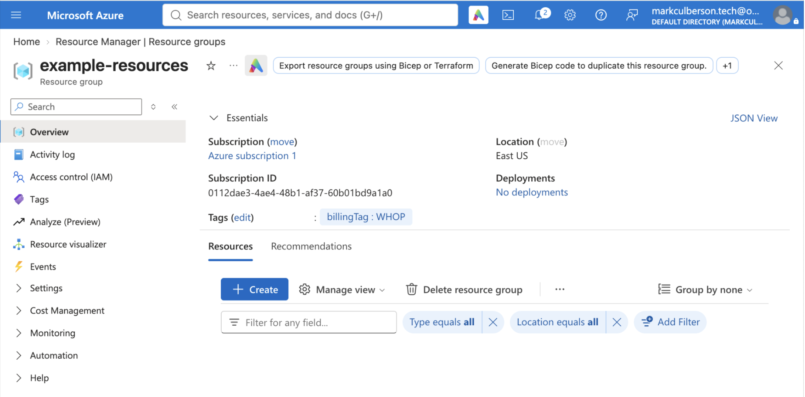

*Resource group overview — captured evidence from this Terraform lab. For the precise plan/apply result, consult the terminal output in the screenshot.*

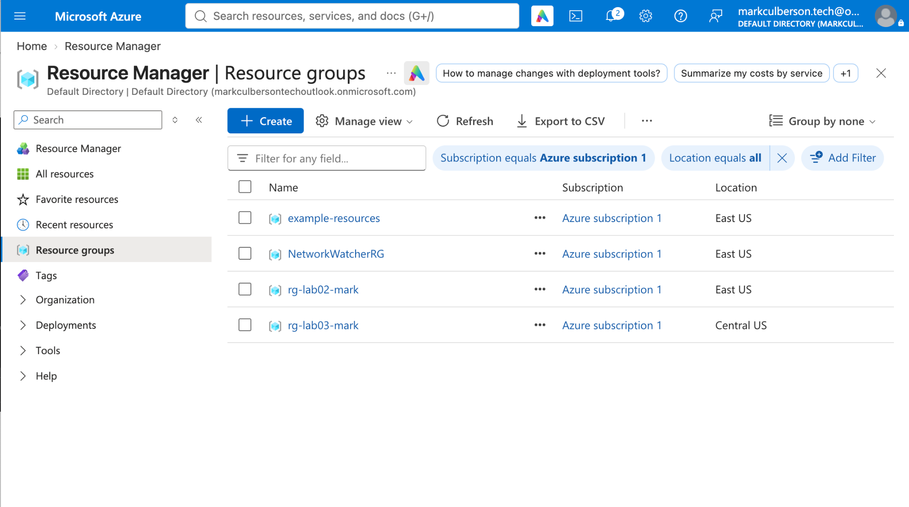

*Resource group inventory — captured evidence from this Terraform lab. For the precise plan/apply result, consult the terminal output in the screenshot.*

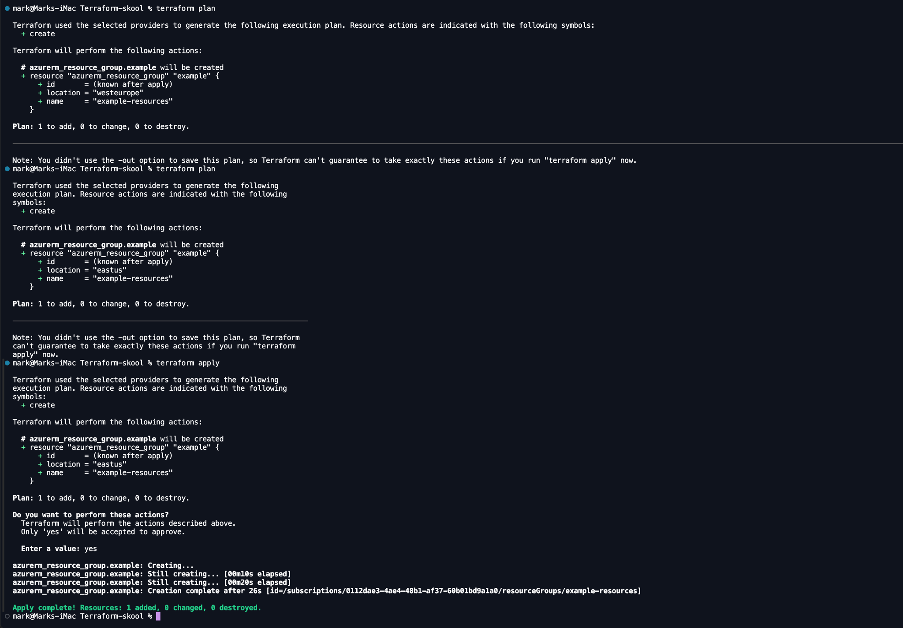

*Initial plan/apply — captured evidence from this Terraform lab. For the precise plan/apply result, consult the terminal output in the screenshot.*

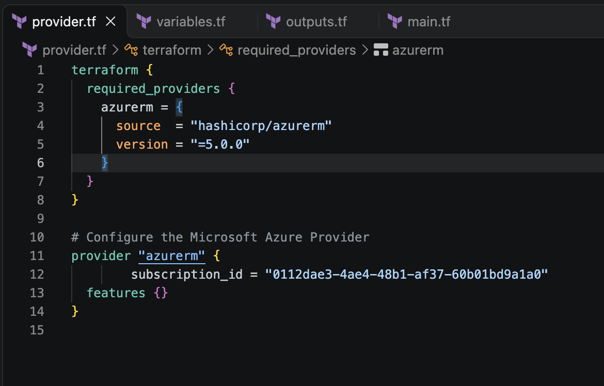

*Provider configuration — captured evidence from this Terraform lab. For the precise plan/apply result, consult the terminal output in the screenshot.*

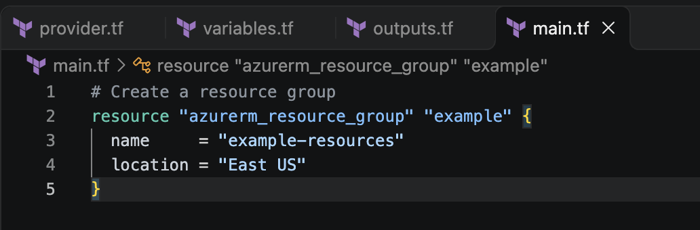

*Resource group code — captured evidence from this Terraform lab. For the precise plan/apply result, consult the terminal output in the screenshot.*

**Engineering takeaway:** Terraform maps desired configuration to planned infrastructure changes; a successful deployment should be corroborated with platform evidence.

### Configuration drift detection and reconciliation

I deliberately added `billingTag=WHOP` in Azure Portal rather than in the Terraform configuration. A subsequent `terraform plan` identified the difference and proposed an in-place update (`0 to add, 1 to change, 0 to destroy`). The storage deployment then reconciled that difference.

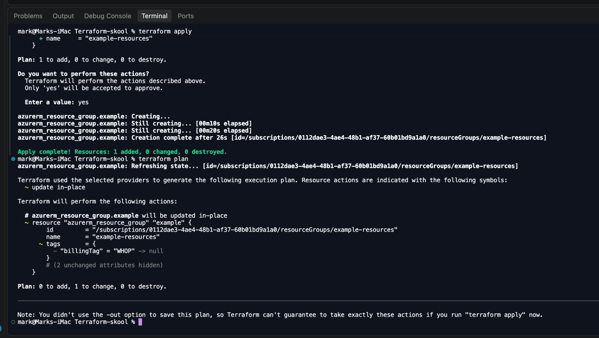

*Drift detection — captured evidence from this Terraform lab. For the precise plan/apply result, consult the terminal output in the screenshot.*

**Engineering takeaway:** Untracked manual changes can create configuration drift. Plan output makes those differences reviewable before an apply.

### Azure Storage provisioning through Terraform

I declared a Standard GRS storage account, applied the configuration, and reviewed the resulting Azure resource. The storage apply reported `1 added, 1 changed, 0 destroyed`—one new resource plus the tag reconciliation.

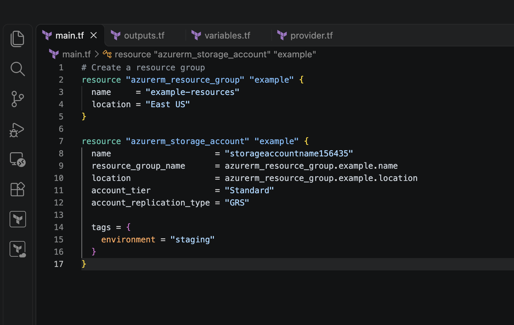

*Storage configuration — captured evidence from this Terraform lab. For the precise plan/apply result, consult the terminal output in the screenshot.*

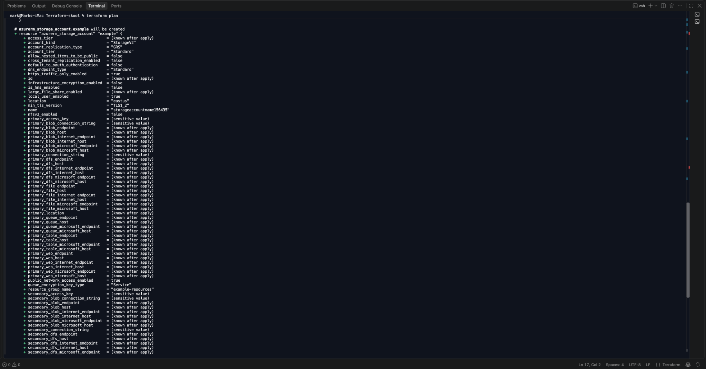

*Storage plan — captured evidence from this Terraform lab. For the precise plan/apply result, consult the terminal output in the screenshot.*

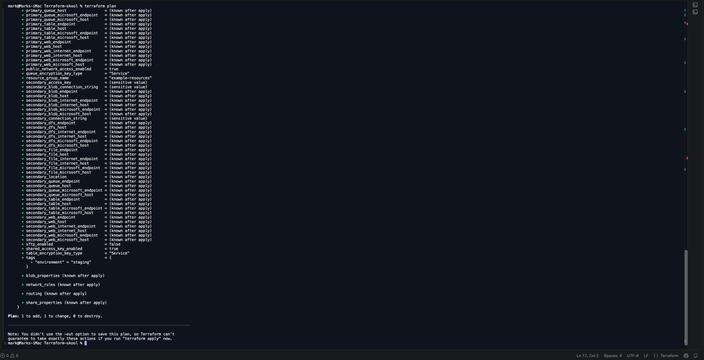

*Storage plan summary — captured evidence from this Terraform lab. For the precise plan/apply result, consult the terminal output in the screenshot.*

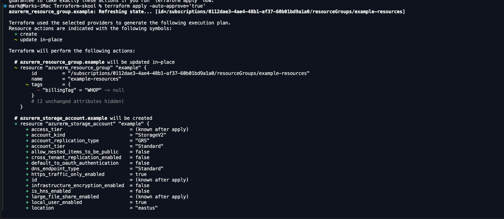

*Storage apply — captured evidence from this Terraform lab. For the precise plan/apply result, consult the terminal output in the screenshot.*

**Engineering takeaway:** A plan describes intended changes; apply output establishes that Terraform executed them. The Azure resource overview is a separate verification point.

### Expanding the infrastructure: networking and observability

I expanded the Terraform configuration to describe a virtual network (`10.0.0.0/16`), two subnets (`10.0.1.0/24` and `10.0.2.0/24`), a network security group attached to `subnet2`, and a Log Analytics workspace with 30-day retention.

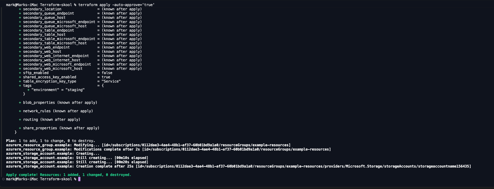

*Expanded Terraform source — captured evidence from this Terraform lab. For the precise plan/apply result, consult the terminal output in the screenshot.*

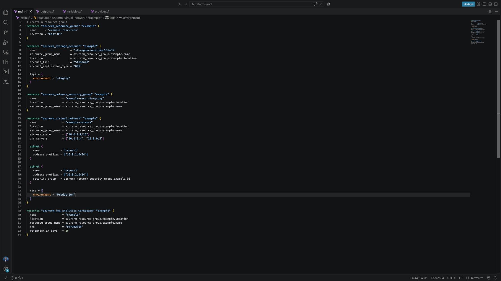

*Expanded plan — captured evidence from this Terraform lab. For the precise plan/apply result, consult the terminal output in the screenshot.*

**Engineering takeaway:** Declarative provisioning can express related compute-adjacent building blocks together, but configuration and deployment evidence must be distinguished.

### Troubleshooting an Azure resource-provider dependency

An apply partially succeeded, creating the VNet and NSG, but the Log Analytics deployment returned HTTP `409 MissingSubscriptionRegistration` because the subscription had not registered `Microsoft.OperationalInsights`. I used Azure Resource providers to register the namespace and reran Terraform.

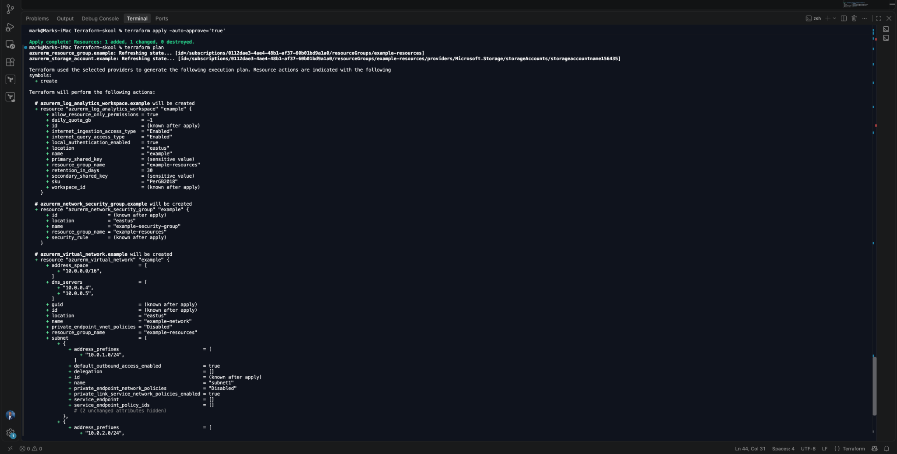

*Resource provider registration attempt — captured evidence from this Terraform lab. For the precise plan/apply result, consult the terminal output in the screenshot.*

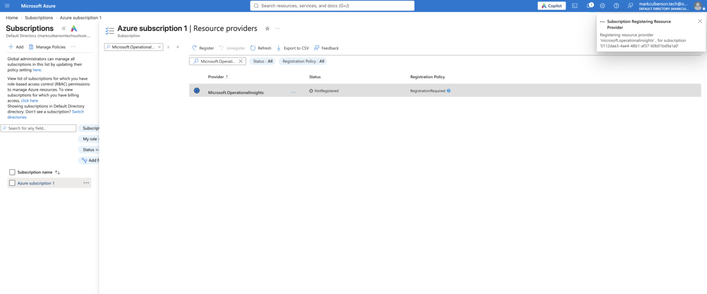

*Provider registration progress — captured evidence from this Terraform lab. For the precise plan/apply result, consult the terminal output in the screenshot.*

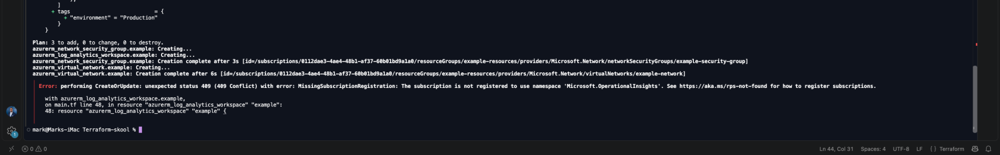

*Log Analytics retry — captured evidence from this Terraform lab. For the precise plan/apply result, consult the terminal output in the screenshot.*

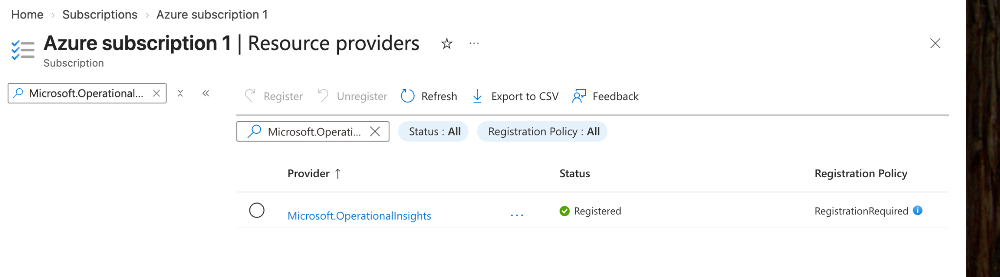

*Provider registered — captured evidence from this Terraform lab. For the precise plan/apply result, consult the terminal output in the screenshot.*

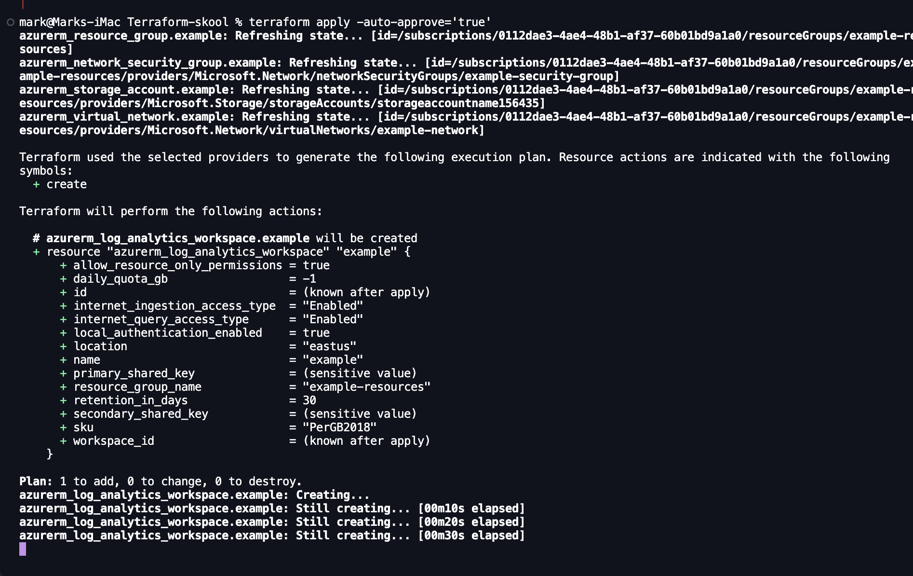

*Retry plan — captured evidence from this Terraform lab. For the precise plan/apply result, consult the terminal output in the screenshot.*

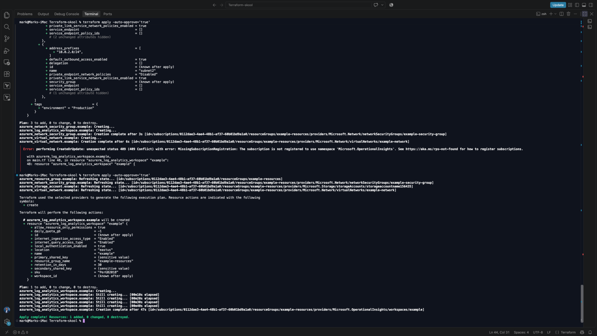

*Apply success — captured evidence from this Terraform lab. For the precise plan/apply result, consult the terminal output in the screenshot.*

**Engineering takeaway:** Terraform syntax is only one layer of correctness. Subscription resource-provider registration is an Azure control-plane prerequisite, and failed applies can leave successfully created resources in place.

### Azure Portal verification: resulting resources

After retrying, the Log Analytics workspace was created successfully (`1 added, 0 changed, 0 destroyed`). The repository includes Azure Portal views of the workspace, storage account, NSG, and VNet.

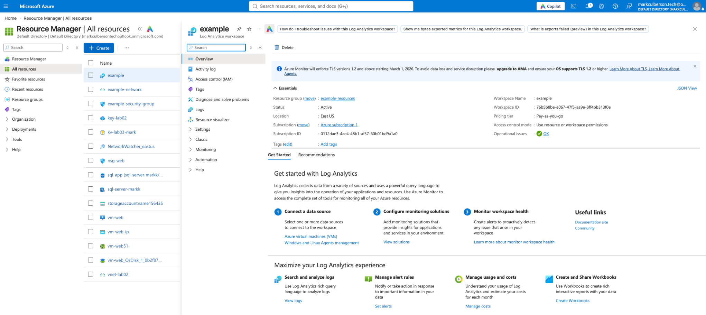

*Workspace verification — captured evidence from this Terraform lab. For the precise plan/apply result, consult the terminal output in the screenshot.*

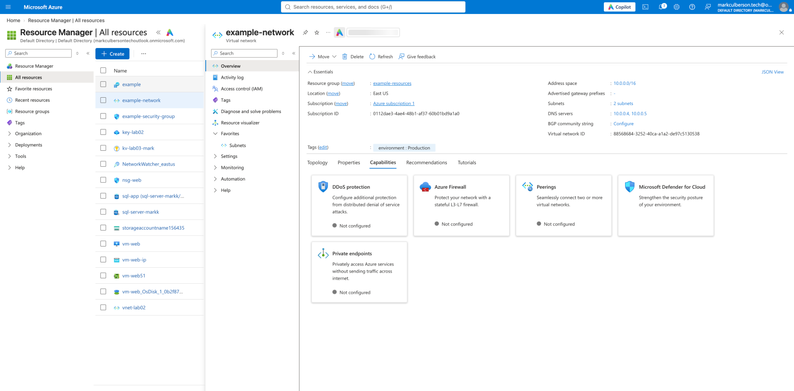

*Storage verification — captured evidence from this Terraform lab. For the precise plan/apply result, consult the terminal output in the screenshot.*

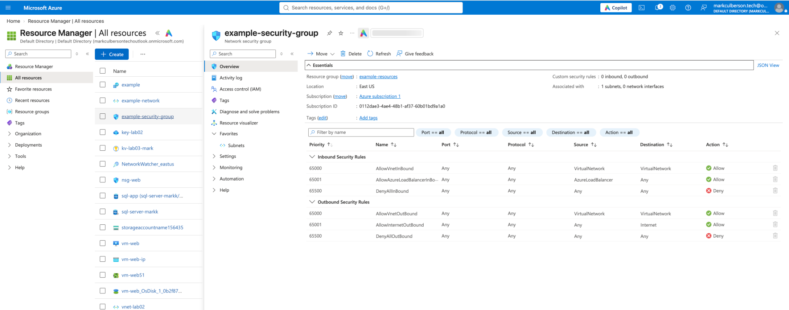

*NSG verification — captured evidence from this Terraform lab. For the precise plan/apply result, consult the terminal output in the screenshot.*

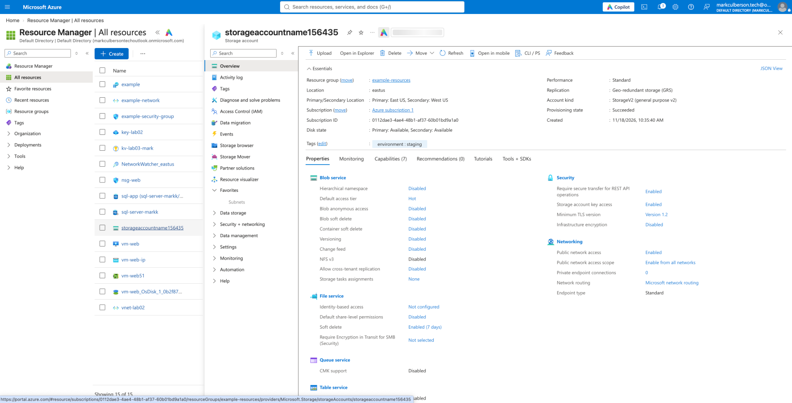

*VNet verification — captured evidence from this Terraform lab. For the precise plan/apply result, consult the terminal output in the screenshot.*

**Engineering takeaway:** Portal evidence validates resource existence and visible settings; it does not by itself establish functional telemetry ingestion or an end-to-end security test.

### Evidence boundaries

- The repository contains screenshot evidence for **resource configuration, Terraform plan/apply steps, drift detection, provider registration, and Azure Portal resource views**.
- **Not established by the available evidence:** a final no-change `terraform plan`, a completed `terraform destroy`, actual Log Analytics ingestion or alerting, network traffic validation, remote state backend protections, or production hardening.
- The screenshot sequence skips the filename prefix `15`; no image for that number exists in the repository. This README intentionally references **only existing files**.
- Review every screenshot and HCL file for identifiers, tokens, account details, and other sensitive material before further distribution.

## Skills demonstrated

**Infrastructure as Code:** Terraform · HCL · Declarative Configuration · Plan/Apply Workflows · Desired-State Management · Configuration Drift Analysis  
**Microsoft Azure:** Resource Groups · Azure Storage · VNets · Subnets · Network Security Groups · Log Analytics · Resource Provider Registration  
**Engineering practices:** Azure Portal Verification · Error Interpretation · Deployment Troubleshooting · Partial-Failure Recovery · Documentation · Security and Cost Awareness

## Terraform workflow

```bash
terraform init
terraform fmt -check
terraform validate
terraform plan
terraform apply

# Inspect the actual deployed state and any potential drift
terraform plan

# Review the proposed deletion plan before any cleanup
terraform destroy
```

**Note:** These commands are a reference workflow. This README does not claim that every command above was captured or run, especially the final no-change plan and destroy. Always inspect plans before changing shared resources.

## Repository contents

| Path | Purpose |
|---|---|
| [`main.tf`](main.tf) | Sanitized reconstruction of Azure resource declarations from the lab |
| [`provider.tf`](provider.tf) | AzureRM provider settings without a hardcoded subscription identifier |
| [`.gitignore`](.gitignore) | Ignore rules for local Terraform state, plans, and sensitive files |
| [Architecture diagram](docs/azure-terraform-infrastructure-architecture.svg) | High-level visual of the configured infrastructure |
| [Screenshots](screenshots/) | 22 evidence images covering HCL, CLI output, Azure troubleshooting, and verification |
| [Evidence checklist](docs/evidence-checklist.md) | Supplemental checklist; some older suggested filenames differ from the actual screenshots |

> **Code provenance:** `main.tf` was reconstructed from captured screenshots, not copied from a complete verified local working directory. The original `variables.tf`, `outputs.tf`, and full provider setup were not available for inspection. Verify the published files against your working implementation before presenting them as a reproducible deployment.

## Future improvements

For a stronger follow-up iteration, I would:

1. Capture a final **no-change** Terraform plan to establish desired-state consistency.
2. Add automated `terraform fmt` and `terraform validate` checks in CI.
3. Evaluate a secure remote state backend with restrictive access and locking.
4. Replace broad storage access with identity-based access controls and tighter network restrictions where appropriate.
5. Define reviewed NSG rules and validate network flows.
6. Connect diagnostic sources to Log Analytics and demonstrate an actual ingested query.
7. Add evidence of approved teardown and cost cleanup where performed.

These are **next steps**, not features claimed as completed.

## Cost management

Azure Storage, networking, and Log Analytics resources can create charges depending on consumption and configuration. Review the Azure cost estimate and the Terraform destroy plan before cleanup. No completed teardown is established by the existing evidence.

---

**Author: Mark Culberson**  
**Project focus:** Azure Infrastructure as Code • Terraform • Troubleshooting • Cloud Engineering
